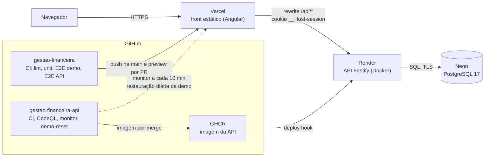
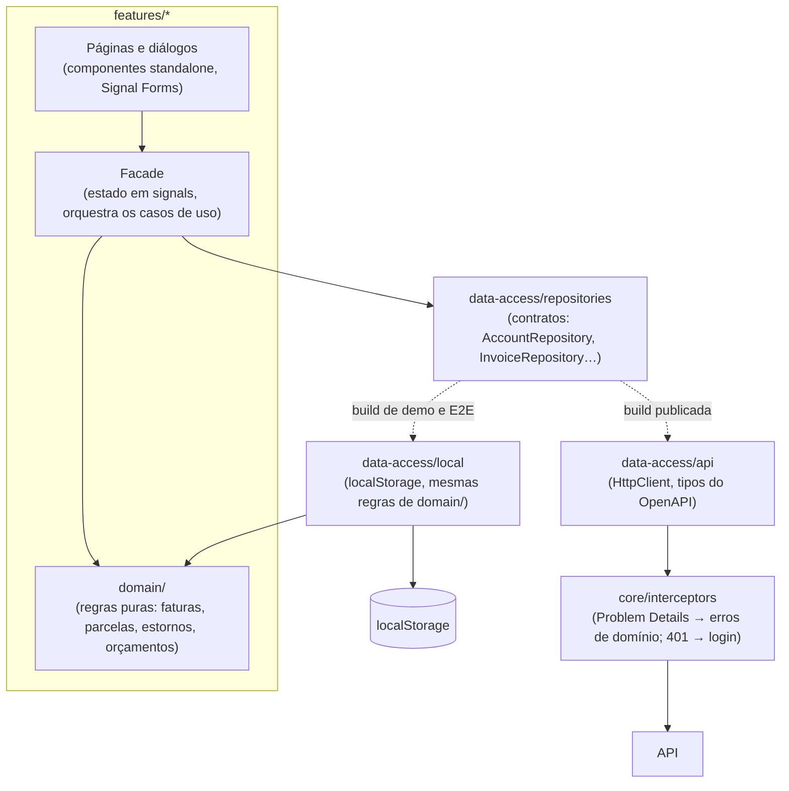

# Arquitetura

Como o projeto está montado, da publicação ao código. As decisões por trás de cada escolha estão em [`docs/adr/`](adr/README.md).

## Implantação



- **Mesma origem:** o navegador só fala com o domínio da Vercel. O `rewrite` de `/api/*` (`vercel.json`) leva os pedidos à API, então o cookie de sessão é do domínio do front e não há CORS ([ADR 0003](adr/0003-proxy-api-na-vercel.md)).
- **Contrato:** a API publica o `openapi.json`; o front gera os tipos dele com `npm run api:types`. Uma mudança no contrato aparece como erro de compilação no front.
- **Deploy:** um merge na `main` do front publica na Vercel; um merge na `main` da API publica a imagem no GHCR e pede o deploy ao Render, que aplica as migrações na subida.

## Camadas do front



- **Telas não conhecem HTTP:** usam a facade da funcionalidade, que depende só dos contratos de repositório.
- **Duas implementações dos contratos** ([ADR 0002](adr/0002-repositorios-api-e-local.md)): `data-access.providers.ts` registra a da API; a configuração `demo` troca o arquivo por `data-access.providers.demo.ts` (`fileReplacements`), que registra a do `localStorage`. Nenhuma tela muda.
- **Regras de domínio puras** em `features/*/domain/`: funções sem Angular, testadas com os mesmos casos da API ([ADR 0006](adr/0006-regras-repetidas-no-front.md)). Na build publicada, a API calcula; na demo, essas funções calculam sobre os dados do navegador.
- **Erros:** o interceptor converte as recusas da API (Problem Details) em `ApiProblemError`; cada repositório traduz para o erro de domínio que a tela já sabe exibir (fatura paga, registro alterado em outra aba, valor acima do saldo).

## Pastas

```text
src/app/
  core/          # Autenticação, guards, layout, interceptors, preferências, i18n
  shared/        # Componentes, pipes, diretivas e utilitários sem regra de negócio
  features/      # Uma pasta por funcionalidade: páginas, facade, domain/ e forms/
  data-access/
    repositories/  # Contratos
    api/           # Implementações contra a API
    local/         # Implementações no localStorage (demo e E2E)
```
